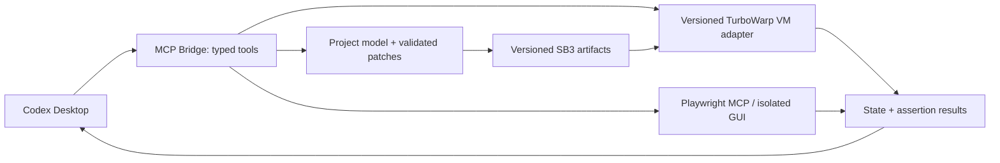

# TurboWarp 专用 MCP Bridge 可行性设计

状态：P4 技术选型与小型实验；完整 Bridge 尚未实现。本文方案是基于本机实验的工程建议，不能当作已交付工具目录。

## 技术选择

推荐 Node.js + TypeScript + 官方 MCP SDK，采用 STDIO，工作区限制在每个项目目录内。项目编辑优先使用 `.sb3` 的结构化模型；运行、导入和导出复用 TurboWarp VM；真实输入与编辑器验收复用 Microsoft Playwright MCP。不把鼠标拖拽当成代码生成主路径。

| 组件 | 本轮依据 | 建议 |
| --- | --- | --- |
| TurboWarp VM | 官方 `loadProject`、`saveProjectSb3`、`postIOData`、`addSprite`、`addCostume` 与 COMPILE_ERROR 源码已阅读；本机 load/save 和状态读取有实验 | 作为运行引擎；锁定版本并建立适配器 |
| TurboWarp GUI | 在线编辑器实际加载，舞台、分类、角色、标签页均已定位 | 作为真实集成测试与人工查看入口；长期固定本地 GUI 版本，在线站点作为兼容性测试 |
| SB3 | ZIP + project.json + 内容哈希命名素材；21 个主体积木加载后展开为 36 个含影子积木的 VM 节点 | 用 block ID、target ID、variable ID 表达补丁；区分磁盘序列化与 VM 展开形式 |
| Playwright MCP | 官方 0.0.83 服务经过标准 MCP SDK 实际调用 | UI 输入、截图、日志和 DOM；限制到独立测试浏览器，避免任意 Node 代码执行工具 |
| Extension API | 官方文档说明沙箱扩展与 unsandboxed 扩展能力不同 | 不作为默认控制通道；本轮未加载扩展，不申请额外权限。VM 访问已可满足实验 |
| TextToScratch | 官方文档说明 TypeScript 到标准积木、CLI 构建和块到文本转换；反编译会产生 unsupported 项并重建布局 | 可选编译前端；未安装、未验证。新项目可试，已有项目不可默认无损往返 |
| tosh / Leopard | 各自官方仓库已调查 | 前者是另一套文本编辑路线，后者偏 Scratch 风格 JavaScript；都不能替代本轮已验证的 SB3/VM 通道，暂不纳入依赖 |

现阶段只为验收样例实现了有限积木生成器。不能将其当作通用 Scratch 编译器或完整格式验证器。后续应复用官方 scratch-parser schema、VM 的序列化/反序列化，再为支持的 opcode 建立明确的输入类型约束。

## 数据与运行路径

编辑流程：读取 SB3 → 验证 ZIP 与模型 → 为当前版本创建快照 → 检查补丁前置哈希 → 修改副本 → 静态验证 → 写临时文件 → VM 加载 → 执行断言 → 成功后原子提交。失败保留原件、补丁、结果和候选项目。修改已有作品只更新指定 target/block，保留未知字段、未知 opcode、素材和扩展元数据。

在线 `window.vm` 本轮可用，但不应视为永久公开稳定接口。适配器启动时检查 `loadProject`、`saveProjectSb3`、`runtime.targets` 与 `setEditingTarget` 是否存在，探针失败即 BLOCKED，不做静默兼容猜测。读取 `_blocks` 等私有字段需要独立版本适配与测试。

## 拟议工具接口（尚未实现）

所有写操作接收 projectId、expectedRevision 和 requestId；所有文件以工作区内相对路径或服务签发的 artifactId 引用。禁止任意文件路径、任意 JavaScript 和 shell 命令接口。

| 工具 | 输入要点 | 输出要点 |
| --- | --- | --- |
| project.create | 模板、舞台尺寸、角色与变量声明 | projectId、revision、静态诊断 |
| project.open | artifactId、只读或副本模式 | targets、素材、脚本摘要、revision |
| project.inspect | targetId、blockId 范围、字段选择 | 局部结构、未知能力、引用图 |
| project.apply_patch | base revision、类型化操作列表、dryRun | 变更摘要、候选 revision、验证结果 |
| runtime.load | projectId、revision、engine mode | sessionId、VM/GUI 版本、能力探针 |
| runtime.input | 键盘按下/抬起、鼠标坐标/按钮、相对帧序列 | 已处理输入序号、时间/帧编号 |
| runtime.state | targetIds、变量 ID、线程摘要 | 有界状态快照、增量变化 |
| test.run | testSuiteId、seed、timeout、maxSteps | 每项 PASS/FAIL、expected/actual、失败定位 |
| artifact.save | sessionId、目标 artifactId、覆盖前置哈希 | SB3 哈希、报告路径、快照 ID |
| project.rollback | projectId、snapshotId、expectedRevision | 恢复后的 revision |

补丁操作示例：addSprite、addCostume、declareVariable、replaceScript、setBlockInput。生成时分配唯一 ID，检查 next/parent、输入引用、变量作用域、自定义积木 mutation 与参数 ID；不把任意 JSON Patch 直接写入未经验证的项目。

## 运行与测试约束

1. 两层测试：快速 VM 状态测试负责多数逻辑；真实 GUI 键鼠测试负责输入焦点、渲染和文件导入/导出集成。
2. 本轮用真实浏览器按键和鼠标；读取 VM 的 x/y、变量、线程作为断言。等待目标变量变化有 3 秒期限，不用截图推断逻辑。
3. 后续确定性运行需要固定 VM、随机种子、时钟、步进与编译器模式。`runtime._step` 属私有实现，尚未验证，不宣称当前测试按帧确定性。
4. 收集 window error、unhandledrejection、COMPILE_ERROR、浏览器 console、超时与线程不收敛；不是所有 Scratch 逻辑错误都会抛异常，必须依赖作品规格断言。
5. 失败返回 `{testId,targetId,blockId?,expected,actual,revision,lastInput,artifactRefs}`。先让 Codex查看局部脚本与状态，再提出最小补丁，跑失败项和回归集，通过后保存。
6. 本轮故意将右移量从 10 改为 5，要求实际 x=5 且 x=10 断言被拒绝；再仅修复该输入为 10，验证其他 JSON 字段不变并重复键盘回归。这只证明一个受限修复案例。

## 文件安全与回滚

工作区根目录 canonicalize 后再做路径边界检查，拒绝 `..`、绝对外部路径、符号链接/reparse point 越界、ZIP 路径穿越；对 ZIP 条目数、解压大小、压缩比和媒体大小设限。未知远程扩展默认不加载。写入先保存 SHA-256 快照，再用预期哈希控制并发，原子重命名提交；报告与项目一同关联 revision。上述完整通用保护属于下一阶段，当前脚本只读取代码中固定的项目内样例文件。

现有 Codex 集成保留 Chromium 沙箱、独立内存 profile；未启用 CDP 对用户浏览器的接管、扩展、无限文件访问、忽略 TLS 错误或额外站点权限。禁用了 MCP 的 browser_run_code_unsafe；browser_evaluate 仍可执行页面 JavaScript，须限定在可信测试项目流程。

## 减少交互与 Token

一次结构化批量编辑，多次本地断言；只有失败和视觉验收才截图。返回变化的变量与局部积木，完整日志放文件；稳定选择器缓存需带 GUI 版本，版本不符重新探测。素材通过 artifactId 传递，避免大文件 base64 穿过对话。当前小实验用 base64 是为了无需网络服务器传递 2–4 KB 样例，不能照搬到大型项目。

## 下一阶段实施计划

1. 先完成当前 Desktop 原生工具目录刷新与实际调用验收；保持当前 MCP 注册名唯一。
2. 单独授权完整 Bridge 后，固定 GUI/VM 版本，建立本地离线 fixture 与能力探针，复用官方 schema。
3. 实现 project.open/inspect 与只读状态，随后实现事务化 apply_patch、快照和回滚。
4. 实现有界键鼠输入与 test.run，覆盖变量作用域、克隆、广播、自定义积木、造型和存档重载；定义未知扩展策略。
5. 增加受控修复循环与错误定位；每个变更通过结构、VM、GUI 三层验证后交付。
6. 最后单独评估 TextToScratch：固定来源/版本，测试编译与反编译覆盖率，再决定是否采用。当前不额外安装浏览器扩展。

## 官方与项目一手资料

- [Microsoft Playwright MCP](https://github.com/microsoft/playwright-mcp)，已保存本轮 README。
- [Codex MCP 配置](https://learn.chatgpt.com/docs/extend/mcp?surface=cli)，支持 STDIO、cwd 与工具禁用配置。
- [TurboWarp VM 源码](https://github.com/TurboWarp/scratch-vm)，本地保存 virtual-machine.js、runtime.js、sb3.js；源码 SHA-256 见 reports/source-hashes.json。
- [TurboWarp GUI](https://github.com/TurboWarp/scratch-gui)。
- [Scratch parser](https://github.com/scratchfoundation/scratch-parser)。
- [Extension API 入门](https://docs.turbowarp.org/development/extensions/introduction)、[unsandboxed 说明](https://docs.turbowarp.org/development/extensions/unsandboxed)。
- [TextToScratch CLI](https://texttoscratch.github.io/docs/cli/)、[反编译限制](https://texttoscratch.github.io/docs/decompile/)、[源码仓库](https://github.com/TextToScratch/TextToScratch)。
- [tosh](https://github.com/tjvr/tosh)、[Leopard](https://github.com/leopard-js/leopard)。
